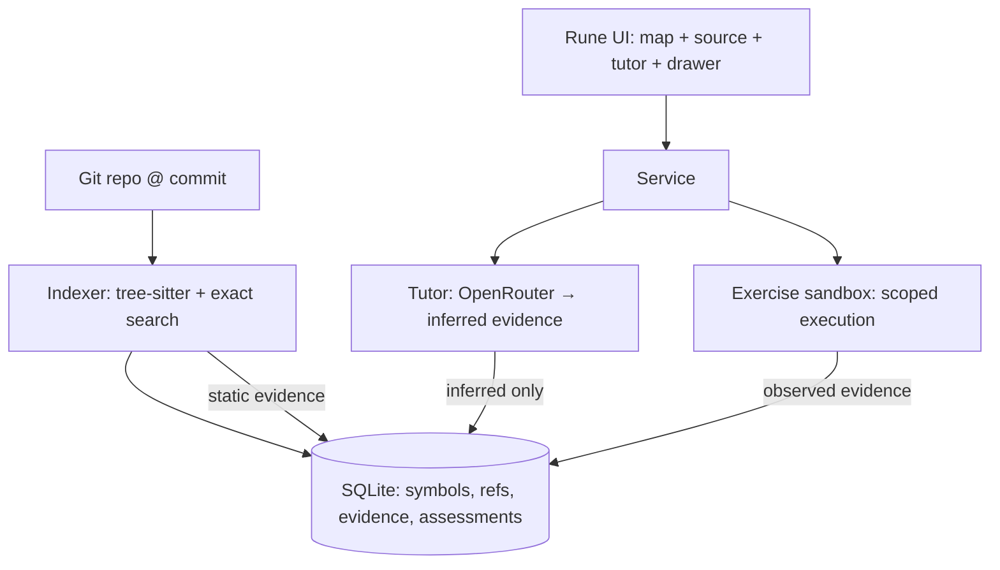

# VIVA — Understanding Your Own Code - Plan

## Goal Capsule

- **Objective:** A developer can point VIVA at a repository, ask "how does sign-in actually reach the database," get an answer anchored to the exact files and commit, be quizzed until they can defend the behavior, and leave with inspectable mastery records — not a generated summary they could fake having read.
- **Means:** One Rust binary — commit-pinned indexer (tree-sitter → SQLite graph), tutor service, and Rune UI — with three visibly distinct evidence categories (KTD1–KTD4).
- **Authority:** `docs/BRIEF.md` governs product scope and the evidence/assessment rules; this plan governs implementation; `AGENTS.md` and `duketopceo/luke-agents` govern standards.
- **Stop conditions:** the release gate in the brief passes on three journeys — explanations resolve to the correct revision, unsupported claims are identified, exercises are permission-controlled, learner answers produce inspectable assessment evidence.
- **Execution profile:** `ce-work` consumes Implementation Units in order; the DeepTutor spike (U10) is evaluative and may conclude "no connector."
- **Who finishes:** implementing agent builds units; owner validates the three journeys on a real repo.

---

## Product Contract

### Summary

VIVA understands a particular revision of executable software. It indexes a repo at a commit, builds a clickable understanding graph connecting features, functions, architecture claims, runtime paths, and learning objectives, and runs a tutor that makes the learner prove understanding. Every explanation resolves to files and revision; static, observed, and inferred evidence are visibly distinct; mastery is recorded per competency, not as one opaque percentage.

### Problem Frame

Codebases outrun any developer's mental model, and "AI summaries" make it worse — fluent prose about code that may not match the revision on disk. DeepTutor covers source-linked learning broadly, but VIVA's wedge is precision: commit-pinned indexing, three honest evidence categories, and assessment records that capture what the learner actually demonstrated. The risk is building another summary generator; the plan is built to prevent exactly that.

### Key Decisions

- **Commit-pinned everything.** Index records, explanations, assessments, and runtime traces all carry the commit SHA (plus working-tree fingerprint when dirty). Governs R4–R6, R20.
- **Three evidence categories, never blurred.** Static / observed / inferred render distinctly; inferred tutor output is labeled interpretation. Governs R9–R11.
- **Syntax-aware indexing first.** tree-sitter + exact search; embeddings assist navigation only, never become the sole retrieval path. Governs R8.
- **DeepTutor is evaluated, not forked.** U10 spike decides connector-vs-standalone on evidence. Governs R22.
- **Mastery per competency.** No aggregate "understanding score"; each assessment retains question, response, rubric, refs, commit, hints, verification. Governs R17–R19.

### Requirements

**Indexing and evidence**

- R1. A repository is indexed at a specific commit: symbols, references, imports, definitions, call edges via tree-sitter.
- R2. Index records are keyed to commit SHA; a dirty working tree gets a fingerprint distinguishing it from the commit.
- R3. Exact search (path, symbol, text) works without any embedding dependency.
- R4. Evidence records carry category (static / observed / inferred), source anchors (file:line + commit), and for observed evidence the execution inputs + environment.
- R5. Static call/reference graphs are never presented as runtime traces.
- R6. Inferred explanations are labeled as interpretation and link to the static evidence they interpret.

**Understanding graph and explorer**

- R7. The main screen combines repository map, source viewer, tutor, and evidence drawer.
- R8. Click-through: feature → entry points/implementation/data access/tests; function → definition/callers/dependencies/questions; claim → supporting code + inferred-vs-observed label; runtime path → trace/env/inputs/linked source; objective → attempts/feedback/evidence/next exercise; commit change → affected concepts and possibly-stale explanations.
- R9. Answers to "how does X reach Y" point to specific files and revision — never a diagram without anchors.

**Tutor and assessment**

- R10. Learning cycle: predict before reveal → retrieve source+tests → targeted hints → assumption-changing follow-up → bounded exercise (where execution permitted) → save demonstrated understanding + gaps.
- R11. Explore mode offers explanations freely; Defend mode requires the learner's answer first. Neither is mandatory.
- R12. Exercises are permission-controlled: execution scope (read-only vs run-tests vs run-commands) is explicit per exercise.
- R13. Follow-ups change an assumption — repeating a definition back is not evidence of understanding (e.g., "what breaks if this check moves").

**Mastery records**

- R14. Competencies tracked individually (trace request, explain state transitions, locate authorization, predict failure, interpret test, bounded change) — no single opaque percentage.
- R15. Each assessment retains question, learner response, rubric, source references, commit, hints used, verification results.
- R16. Passing tests contribute evidence; they do not alone prove understanding.
- R17. Code changes mark related learning evidence `needs review` — no auto-reset, no untouched stale labels.

**Validation**

- R18. First ecosystem: one language (TypeScript via tree-sitter). Second ecosystem only after the slice proves out.
- R19. Three journeys ship: explain main request path; investigate a real failure path; defend and implement a small change.
- R20. Release gate: explanations resolve to correct revision; unsupported claims identified; exercises permission-controlled; learner answers produce inspectable assessment evidence.

### Actors

- **A1 — Learner (primary user):** explores, asks questions, answers challenges, completes exercises.
- **A2 — Tutor (model-backed):** generates explanations, questions, hints — all labeled inferred; retrieves static/observed evidence for grounding.
- **A3 — Repository:** the subject — indexed at pinned commits; changes trigger staleness review.
- **A4 — Exercise sandbox (bounded):** executes permitted commands/tests for observed evidence — scoped, logged, never arbitrary.

### Key Flows

- F1. Open repo → index at commit → explore graph → click to code → ask tutor → answer anchored to file:line@commit.
- F2. Defend session → predict → hints → follow-up → bounded exercise → assessment record saved.
- F3. New commit lands → affected concepts flagged `needs review` → learner re-validates or evidence re-anchors.

### Acceptance Examples

- AE1. Given a repo indexed at commit C, when the learner asks how login reaches the DB, then every step in the answer links file:line at C (or a descendant explicitly marked).
- AE2. Given a static-only explanation of a runtime behavior, when rendered, then it is labeled inferred/static — never observed.
- AE3. Given a learner who correctly recites "middleware checks auth," when the follow-up asks what breaks if the check is removed and which test catches it, then the assessment records both answers separately.
- AE4. Given a new commit touching auth code, when mastery records exist for auth competencies, then they show `needs review` — not silently kept, not wiped.

### Scope Boundaries

**Deferred for later:** additional language ecosystems, DeepTutor deep integration (connector evaluated in U10), embedding-primary retrieval, multi-repo fleet views, auto-generated curricula beyond the three journeys.

**Outside this product's identity:** another generated-code-summary tool, a quiz app without code anchors, an exam the user can't opt out of, opaque mastery percentages.

### Sources

- `docs/BRIEF.md` — product brief (requirements origin)
- `https://github.com/HKUDS/DeepTutor` — overlap analysis; connector evaluation target (U10)
- `https://github.com/anomalyco/rune` — UI framework (`dev@24bd7bbb`)
- tree-sitter + `tree-sitter-typescript` — indexing substrate
- OpenRouter — tutor model calls (explanations labeled inferred)

---

## Planning Contract

### Key Technical Decisions

- KTD1. **Commit-pinned index, append-only.** Index rows carry `commit_sha`; re-indexing a new commit adds rows, never mutates history — explanations stay anchored to what was true when written. (session-settled: user-directed — Rune everywhere; commit-pinning is from the brief.)
- KTD2. **tree-sitter syntax graph + exact search.** Symbols, references, imports via tree-sitter queries; ripgrep-style exact text search; no vector DB in v1.
- KTD3. **Three evidence categories as a schema-level enum.** `static | observed | inferred` on every evidence record; UI badge + label mandatory; inferred requires `model` + `prompt_version` provenance.
- KTD4. **Observed evidence requires recorded execution.** Traces/test runs store inputs, env, command, commit — a claim of observed behavior without a stored run is a schema violation.
- KTD5. **Tutor output is quarantined like VEIN's model gate.** Model calls produce `inferred` evidence only; they can cite static/observed evidence but cannot mint it.
- KTD6. **Assessment records are first-class append-only rows.** Question, response, rubric, refs, commit, hints, verification — the mastery view is a projection, not a score.
- KTD7. **Exercise sandbox is capability-scoped.** Per-exercise permission enum (`read_only | run_tests | run_commands`); commands run in the indexed repo dir with a denylist + timeout; nothing executes without an explicit grant recorded on the assessment.
- KTD8. **DeepTutor evaluated by spike, not adoption.** U10 tests whether its CLI event output + knowledge tools can consume commit-pinned evidence and emit VIVA assessment records; outcome recorded either way.

### High-Level Technical Design

Evidence flow rule: static evidence comes only from the indexer; observed evidence only from recorded executions; inferred evidence only from tutor calls. No path lets one category impersonate another.

### Assumptions

- Rust 1.99.1 toolchain (installed; matches rune's `rust-toolchain.toml`).
- tree-sitter-typescript covers the first ecosystem; grammar quality for TS/TSX is sufficient (verify in U2 with a real repo).
- The org's repos (tallyline, agentflow, wisp, argus) provide real TypeScript targets for journeys.
- OpenRouter models can produce structured tutor output reliably enough for hinted dialogue (verify in U8 spike).
- DeepTutor's CLI shape is as documented; U10 verifies before any connector work.

### Sequencing

Phase 0 (U1–U4): workspace, indexer, evidence schema — everything depends on commit-pinned records.
Phase 1 (U5–U7): understanding graph + explorer views.
Phase 2 (U8–U9): tutor + assessment engine.
Phase 3 (U10–U11): journeys + DeepTutor evaluation + release gate.

---

## Implementation Units

| Unit | Title | Files (primary) | Depends on |
|---|---|---|---|
| U1 | Workspace + service skeleton + Rune shell | `Cargo.toml`, `crates/viva-db/`, `crates/viva-core/` | — |
| U2 | Commit-pinned indexer (tree-sitter) | `crates/viva-index/` | U1 |
| U3 | Evidence + assessment schema | `crates/viva-db/` | U1 |
| U4 | Exact search + symbol/reference queries | `crates/viva-index/`, `crates/viva-core/` | U2, U3 |
| U5 | Understanding graph builder (features/claims/paths) | `crates/viva-core/` | U4 |
| U6 | Repository map + source viewer (Rune) | `crates/viva-ui/` | U5 |
| U7 | Evidence drawer + staleness on commit change | `crates/viva-ui/`, `crates/viva-core/` | U6 |
| U8 | Tutor dialogue engine + OpenRouter spike | `crates/viva-tutor/`, `docs/research/` | U5 |
| U9 | Learning cycle + exercise sandbox + mastery records | `crates/viva-tutor/`, `crates/viva-core/` | U8 |
| U10 | DeepTutor evaluation spike | `docs/research/deeptutor.md` | U9 |
| U11 | Three journeys + release gate | `docs/journeys/`, fixtures | U10 |

### U1. Workspace + service skeleton + Rune shell

- **Goal:** `cargo build` produces a `viva` binary opening a Rune window with repo-picker and honest empty states.
- **Requirements:** R7, R18.
- **Files:** `Cargo.toml`, `rust-toolchain.toml`, `crates/viva-db/`, `crates/viva-index/`, `crates/viva-core/`, `crates/viva-tutor/`, `crates/viva-ui/`.
- **Approach:** workspace crates: `viva-db` (rusqlite + migrations), `viva-index` (tree-sitter parsing, no UI deps), `viva-core` (graph/service logic), `viva-tutor` (dialogue + model calls), `viva-ui` (Rune app). Data under `$XDG_DATA_HOME/viva/`.
- **Test scenarios:** `cargo build --workspace` clean; migration round-trip; headless rune render shows repo picker.
- **Verification:** `cargo build --workspace && cargo test --workspace && cargo clippy --workspace -- -D warnings`.

### U2. Commit-pinned indexer (tree-sitter)

- **Goal:** a git repo indexes at a commit SHA into symbol/reference tables — content never keyed to "latest."
- **Requirements:** R1, R2, R3, KTD1, KTD2.
- **Files:** `crates/viva-index/src/` (parse, queries, store).
- **Approach:** `git2` resolves commit → tree; walk files honoring `.gitignore` (`ignore` crate); tree-sitter-typescript queries extract definitions/references/imports/calls; rows carry `commit_sha` + `file_path` + `byte_range`; working-tree fingerprint (`git status` hash) recorded when dirty. Index is incremental per commit (unchanged blobs skipped by hash).
- **Test scenarios:** fixture TS repo → known symbols indexed with correct ranges; second commit → new rows, old rows intact; dirty tree → fingerprint differs from commit.
- **Verification:** `cargo test -p viva-index` on checked-in fixture.

### U3. Evidence + assessment schema

- **Goal:** three-category evidence and first-class assessment records enforced by schema.
- **Requirements:** R4–R6, R14–R16, KTD3, KTD4, KTD6.
- **Files:** `crates/viva-db/src/schema/` (`0001_index.sql`, `0002_evidence.sql`, `0003_assessments.sql`), `crates/viva-db/src/types.rs`.
- **Approach:** `evidence(id, category ENUM(static|observed|inferred), commit_sha, file_path, byte_range, payload_json, model, prompt_version, execution_ref, created_at)`; `assessment(id, competency, question, response, rubric_json, evidence_ids, commit_sha, hints_used, verification_json, created_at)` append-only; `staleness` computed view mapping commit→affected competencies.
- **Test scenarios:** insert evidence without category → fail; observed evidence without execution_ref → fail; assessment round-trips all fields.
- **Verification:** `cargo test -p viva-db`.

### U4. Exact search + symbol/reference queries

- **Goal:** fast exact retrieval — path glob, symbol name, full-text — plus callers/callees expansion.
- **Requirements:** R3, R8 (partial).
- **Files:** `crates/viva-index/src/search.rs`, `crates/viva-core/src/graph.rs`.
- **Approach:** FTS5 virtual table over symbol names + file text; symbol lookup by name/kind; reference expansion via indexed edges (depth-bounded). No embeddings.
- **Test scenarios:** search "signIn" → definition + callers ranked; FTS finds text in unindexed-by-grammar files; depth cap prevents explosion on hub files.
- **Verification:** `cargo test -p viva-index -p viva-core`.

### U5. Understanding graph builder

- **Goal:** features, functions, architecture claims, runtime paths, and objectives exist as typed nodes with evidence-backed edges.
- **Requirements:** R8, R9, KTD3.
- **Files:** `crates/viva-core/src/graph_build.rs`, `crates/viva-core/src/claims.rs`.
- **Approach:** deterministic first pass: entry points (routes/handlers/main) → call-graph reachability → feature clusters by directory/route convention; architecture claims seeded as `inferred` candidates requiring evidence links; runtime paths populated only from observed evidence (U9) — absent traces show `no observed evidence`, not a guess.
- **Test scenarios:** fixture repo → known entry point reaches known handler through indexed edges; claim without evidence renders as unsupported; runtime path empty-state honest.
- **Verification:** `cargo test -p viva-core`.

### U6. Repository map + source viewer (Rune)

- **Goal:** the explorer screen — map, source viewer, cross-linked — works on a real indexed repo.
- **Requirements:** R7, R8, R9.
- **Files:** `crates/viva-ui/src/map.rs`, `crates/viva-ui/src/source.rs`.
- **Approach:** three-pane layout (map | source | tutor placeholder); map nodes = features/functions grouped by stage; clicking opens source at file:line with evidence-category badges; commit SHA visible in chrome. rune-kit components; verify headlessly.
- **Test scenarios:** headless render on fixture index → element tree shows map nodes, source lines, commit label; click function → callers/dependencies panel populated.
- **Verification:** `cargo build -p viva-ui`; headless snapshots in `docs/screens/`.

### U7. Evidence drawer + staleness on commit change

- **Goal:** every claim/explanation opens its evidence; new commits flag affected concepts `needs review`.
- **Requirements:** R4–R6, R17, R20 (partial).
- **Files:** `crates/viva-ui/src/evidence.rs`, `crates/viva-core/src/staleness.rs`.
- **Approach:** drawer shows category badge, anchors, payload excerpt, execution ref (observed), model+prompt (inferred); staleness = diff changed-files ∩ evidence file set → affected competencies marked. No auto-reset.
- **Test scenarios:** click claim → drawer lists static anchors + inferred label; fixture commit touching auth file → auth competencies show needs_review; untouched competencies unaffected.
- **Verification:** `cargo test -p viva-core`; headless render check.

### U8. Tutor dialogue engine + OpenRouter spike

- **Goal:** tutor conversations run predict→hint→follow-up with grounded retrieval — and model output lands only as `inferred`.
- **Requirements:** R10 (partial), R11, R13, KTD5, KTD8.
- **Files:** `crates/viva-tutor/src/` (dialogue, retrieval, openrouter), `docs/research/tutor-models.md`.
- **Approach:** spike first — sample 2–3 OpenRouter models for structured dialogue output + citation-ish grounding; pick by cost/quality (orchestral-eval key for eval spend per house rules). Dialogue engine: turn state machine enforcing predict-before-reveal in Defend; retrieval injects static evidence anchors into prompts; responses parsed → `inferred` evidence rows citing anchors.
- **Test scenarios:** Defend mode → reveal blocked until learner responds; model output missing anchors → stored but flagged unsupported; spike notes committed with model choices.
- **Verification:** `cargo test -p viva-tutor`; spike doc committed.

### U9. Learning cycle + exercise sandbox + mastery records

- **Goal:** the full cycle runs end-to-end and assessments accumulate per competency.
- **Requirements:** R10–R16, R20.
- **Files:** `crates/viva-tutor/src/cycle.rs`, `crates/viva-core/src/exercise.rs`, `crates/viva-core/src/mastery.rs`.
- **Approach:** cycle orchestrator (predict → retrieve → hint → follow-up → exercise → record); exercise sandbox executes only granted scopes (`read_only | run_tests | run_commands`) with denylist + timeout, output captured as `observed` evidence; mastery view = projection over assessments grouped by competency with `needs_review` flags.
- **Test scenarios:** full cycle on fixture → assessment row has all fields; exercise exceeding scope → refused + recorded; hints-used count captured; mastery projection shows per-competency state.
- **Verification:** `cargo test -p viva-tutor -p viva-core`.

### U10. DeepTutor evaluation spike

- **Goal:** decide connector-vs-standalone on evidence — no fork without proof.
- **Requirements:** R22-equivalent (brief's reuse-vs-fork), KTD8.
- **Files:** `docs/research/deeptutor.md`.
- **Approach:** clone DeepTutor at pinned rev; test whether its CLI event output + knowledge tools can (a) consume commit-pinned VIVA evidence, (b) emit VIVA-shaped assessment records, (c) handle update/staleness behavior. Write findings + recommendation; implement connector only if all three pass cheaply.
- **Test scenarios:** spike doc answers the three questions with command output; recommendation explicit (connector / partial / standalone).
- **Verification:** spike doc committed; no DeepTutor code vendored.

### U11. Three journeys + release gate

- **Goal:** the three brief journeys run on a real repo and the release gate passes.
- **Requirements:** R18–R20.
- **Files:** `docs/journeys/` (request-path, failure-path, defend-and-change), `crates/viva-core/tests/fixtures/`.
- **Approach:** pick a real TypeScript repo (tallyline or agentflow candidate); script each journey; audit every explanation for correct-revision anchors; audit assessments for completeness; verify permission controls held during exercises.
- **Test scenarios:** journey scripts produce evidence-linked transcripts; audit finds zero explanations anchored to wrong revision; exercise log shows only granted scopes executed.
- **Verification:** journey transcripts + audit committed; `cargo test --workspace` green.

---

## Verification Contract

| Gate | Command / check | Applies to |
|---|---|---|
| Build | `cargo build --workspace` | all units |
| Test | `cargo test --workspace` | all units |
| Lint | `cargo clippy --workspace -- -D warnings` + `cargo fmt --check` | all units |
| Index | `cargo test -p viva-index` on fixture + real repo | U2, U4 |
| Schema | `cargo test -p viva-db` category/execution invariants | U3 |
| Tutor spike | committed model evaluation in `docs/research/` | U8 |
| DeepTutor | committed spike findings + recommendation | U10 |
| UI render | headless rune PNG + element-tree dump | U6, U7 |
| Release gate | three journey transcripts + audit | U11 |

No CI exists yet; verification is local and reproducible from this table.

## Definition of Done

- All units merged; `cargo build/test/clippy` clean on `main`.
- Release gate passes: three journeys produce revision-anchored explanations, unsupported claims flagged, exercises permission-controlled, assessments inspectable.
- Spike findings committed (`docs/research/`); DeepTutor recommendation recorded.
- Evidence-category invariants proven by tests (no cross-category impersonation).
- No abandoned-attempt code left in the diff.
- `ROADMAP.md` checkboxes updated to match shipped state.
