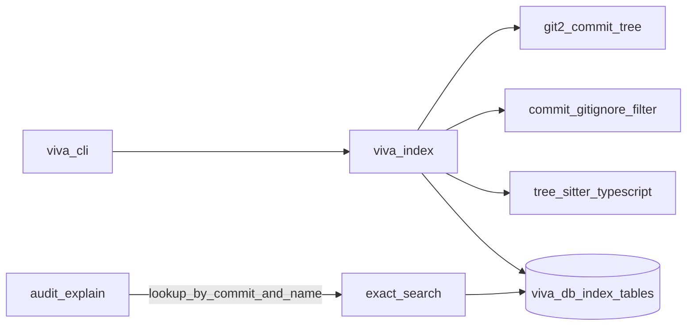

# VIVA — Commit-Pinned Tree-Sitter Indexer Slice

## Goal Capsule

- **Objective:** A TypeScript git repository can be indexed at a pinned commit so every indexed symbol resolves to `file:line` + `commit_sha`, and the HTML audit explain path can cite those static anchors when a match exists.
- **Means:** New `viva-index` crate (`git2` tree walk + commit-scoped gitignore filter + tree-sitter-typescript) writing commit-keyed rows into `viva-db`; CLI subcommands `index` / `search` beside existing dashboard serve; BRIEF-aligned roadmap docs.
- **Authority:** `docs/BRIEF.md` → origin plan `docs/plans/2026-11-12-0000-feat-viva-v1-plan.md` → this slice plan → `AGENTS.md` / luke-agents.
- **Stop conditions:** fixture TS repo indexes at commit C with correct symbol ranges and at least one call edge; second commit leaves prior rows intact; dirty working tree with `--fingerprint-dirty` records a distinct fingerprint; explain attaches symbol line-range static anchors when indexed; `cargo test --workspace` green; drifted full-roadmap rewritten to match BRIEF (no `supersedes` of origin).
- **Execution profile:** `ce-work` consumes units in order; test-first on indexer fixtures.
- **Who finishes:** implementing agent; owner may smoke-index a real repo later (not a gate).

---

## Product Contract

Product Contract preservation: unchanged meaning from origin — this slice implements origin **U2** (indexer) plus the persistence/search needed for origin **R1–R3** (path + symbol exact lookup only; text/FTS deferred). Full R/A/F/AE set remains in `docs/plans/2026-11-12-0000-feat-viva-v1-plan.md`.

### Summary

VIVA understands a particular revision of executable software. This slice delivers commit-pinned index persistence + exact path/symbol lookup + static explain anchors — not the full evidence/assessment schema (origin U3) and not the tutor cycle.

### Requirements (slice-local IDs — map to origin)

| Slice ID | Maps to origin | Obligation |
|---|---|---|
| RS1 | R1 | Index TypeScript at a commit: symbols, references, imports, definitions, **call edges**. |
| RS2 | R2 | Rows keyed by commit SHA; optional dirty fingerprint distinct from clean commit. |
| RS3 | R3 (narrowed) | Exact **path + symbol name** search without embeddings. **Text/FTS and callers/callees expansion deferred** (remainder of origin R3/U4). |
| RS4 | R4 (static only) | Indexer output is **static** evidence only; categories stay distinct when explain attaches anchors. |
| RS-dash | session | HTML audit dashboard + CBM/graphify honest degrade stay intact. |

### Scope Boundaries

**In this PR/slice:** `viva-index` crate, symbol/reference/edge schema, CLI `index`/`search` (+ keep dashboard serve), fixture tests, BRIEF-aligned roadmap docs.

**Deferred to Follow-Up Work:** origin U3 evidence/assessment schema, FTS5 text search, understanding graph (U5), Rune UI (U6–U7), tutor/mastery (U8–U9), DeepTutor (U10), journeys (U11).

**Outside this product's identity:** embedding-only retrieval; inventing graph claims when adapters are absent; treating the audit dashboard as the whole product.

---

## Planning Contract

### Key Technical Decisions

- KTD1. **Commit-pinned rows only.** Every symbol/reference/edge row carries `commit_sha` matching its `index_runs` parent. (from origin KTD1)
- KTD2. **Syntax-aware first.** tree-sitter-typescript (`LANGUAGE_TYPESCRIPT`) + exact search; no embeddings. Prefer tree-sitter; if grammar crates fail to build, stop with blocker — do not silently ship regex stubs while claiming RS1. (from origin)
- KTD3. **New `viva-index` crate** with no UI deps; `viva-db` owns persistence; `viva-core`/`viva` orchestrate.
- KTD4. **HTML audit remains the Phase-0 wedge** ahead of Rune. (session-settled: user-approved — chosen over Rune-as-Phase-0-blocker: first-slice dashboard already ships)
- KTD5. **Missing CBM/graphify degrade unchanged.** Retrieval reports `Absent`; evidence never invents graph anchors. (session-settled: user-approved)
- KTD6. **Unit cut = indexer + path/symbol search + docs.** Origin U3 assessment schema stays follow-up.
- KTD7. **CLI shape:** `viva serve` (current dashboard, keep as default or explicit), `viva index`, `viva search` — do not break dashboard-only `db`/`repo`/`port` without a migration path; prefer clap subcommands with `serve` as default when no subcommand given.

### Slice ↔ origin unit map

| This plan | Origin plan |
|---|---|
| IDX-U1 docs | (docs hygiene; not origin U1) |
| IDX-U2 schema | supports origin U2 |
| IDX-U3 indexer | origin U2 |
| IDX-U4 CLI/search/explain | origin U4 (symbol/path only) + dashboard wedge |

### High-Level Technical Design

Directional: resolve commit → filter tree paths with `.gitignore` **blob at that commit** → parse TS/TSX → upsert symbols, references, and call edges → expose lookup by `(commit_sha, name)`.

### Assumptions

- Toolchain matches `rust-toolchain.toml` (currently `1.100.0`), edition 2024.
- tree-sitter 0.24 + tree-sitter-typescript 0.23 build on aarch64 Linux via `cc` (not bindgen).
- Fixture strategy: checked-in `ts-mini` sources; tests copy into `tempfile` and init git via `git2` (no fragile checked-in `.git`).
- Headless LFG unit cut: indexer + path/symbol search — not origin U3 assessment schema (KTD6).
- Prefer `git2` with `vendored-libgit2` for reproducible CI linking.
- Fingerprint for dirty trees: reuse or export one named helper from `viva-core` (or shared util) so `index_runs.working_tree_fingerprint` and explain targets do not disagree; document if two algorithms must coexist.

### Sequencing

IDX-U1 docs → IDX-U2 schema → IDX-U3 indexer → IDX-U4 CLI/search/explain.

---

## Implementation Units

| Unit | Title | Depends |
|---|---|---|
| IDX-U1 | BRIEF-align roadmap docs | — |
| IDX-U2 | Index schema in viva-db | IDX-U1 |
| IDX-U3 | viva-index: commit walk + tree-sitter + fixtures | IDX-U2 |
| IDX-U4 | CLI index/search + explain static anchors | IDX-U3 |

### IDX-U1. BRIEF-align roadmap docs

- **Goal:** Rewrite drifted `docs/plans/2026-11-13-0000-feat-viva-full-roadmap-plan.md` to match BRIEF + origin v1; update `ROADMAP.md` Phase 0 for landed HTML audit wedge + indexer next.
- **Requirements:** product identity.
- **Files:** `docs/plans/2026-11-13-0000-feat-viva-full-roadmap-plan.md`, `ROADMAP.md`
- **Approach:** Full-roadmap `product_contract_source` = BRIEF or origin plan; **remove `supersedes` of origin**; Progress baseline: audit dashboard done, indexer next; units mirror origin U1–U11. ROADMAP Phase 0 notes HTML wedge (not Rune-only).
- **Acceptance checks:** full-roadmap has no `supersedes: ...viva-v1-plan`; cites origin path; Goal describes understanding-your-own-code; ROADMAP Phase 0 mentions commit-pinned indexer.
- **Test expectation:** none -- docs only.
- **Verification:** acceptance checks above.

### IDX-U2. Index schema in viva-db

- **Goal:** Persist index runs, symbols, references, and call edges keyed by commit SHA.
- **Requirements:** RS1, RS2, KTD1.
- **Files:** `crates/viva-db/src/lib.rs` (or `index_schema.rs`), tests
- **Approach:** Tables:
  - `index_runs(id, repo_root, commit_sha, working_tree_fingerprint, created_at)`
  - `symbols(id, run_id, commit_sha, file_path, name, kind, start_byte, end_byte, start_line, end_line)` with FK `run_id` and `commit_sha` matching parent run
  - `references(...)` same shape for imports/refs
  - `symbol_edges(id, run_id, commit_sha, from_symbol_id, to_name, kind)` where `kind` includes `call` (and optionally `import`)
  Lookup API: `find_symbols(commit_sha, name) -> Vec<SymbolRow>`.
- **Test scenarios:**
  - Insert symbol for commit A; query by name returns commit A.
  - Insert for commit B same path; both coexist.
  - Insert call edge `signIn`→`validate`; query returns edge at commit A.
  - Row with mismatched `commit_sha` vs parent run rejected or CHECK fails.
- **Verification:** `cargo test -p viva-db`

### IDX-U3. viva-index: commit walk + tree-sitter + fixtures

- **Goal:** Index a git commit's TypeScript tree into the schema.
- **Requirements:** RS1, RS2, KTD1–KTD3.
- **Files:** `crates/viva-index/` (new workspace member), `crates/viva-index/tests/fixtures/ts-mini/`, root `Cargo.toml` (+ workspace deps: `git2` vendored, `tree-sitter`, `tree-sitter-typescript`, `ignore`)
- **Approach:** `git2` resolve commit → tree; load `.gitignore` (and `.git/info/exclude` if present) **from that commit's blobs**; filter paths before parse; parse `.ts`/`.tsx` with tree-sitter-typescript; write symbols/refs/call edges; `--fingerprint-dirty` computes fingerprint via shared helper. Skip optional blob-oid incremental optimization (post-MVP).
- **Test scenarios:**
  - Fixture `src/auth.ts` exports `signIn` calling `validate` → symbol + call edge; lines + commit match.
  - Second commit adds `signOut` → new rows; prior commit rows intact.
  - Dirty file + fingerprint flag → fingerprint ≠ clean.
  - Path matching commit `.gitignore` skipped.
  - Non-TS skipped without error.
- **Verification:** `cargo test -p viva-index`
- **Execution note:** test-first — fixture + failing tests before parser wiring.

### IDX-U4. CLI index/search + explain static anchors

- **Goal:** Operator can index/search; explain attaches static anchors with **indexed symbol line ranges** when label matches a symbol at the target commit.
- **Requirements:** RS3, RS4, RS-dash, KTD4, KTD5, KTD7.
- **Files:** `crates/viva/src/main.rs`, `crates/viva-core/src/lib.rs`
- **Approach:** clap subcommands: default/`serve` keeps dashboard; `index <repo> --commit <sha> [--fingerprint-dirty]`; `search <name> [--commit <sha>]`. Explain: `find_symbols(target.commit_sha, label)` → `EvidenceCategory::Static` with `CodeAnchor` from symbol rows; if none, existing path-search/degrade. Regression: retrieval `codebase_memory`/`graphify` remain `Absent` when adapters absent; no invented graph evidence.
- **Test scenarios:**
  - After index, search `signIn` returns path + lines + commit.
  - Explain after index includes static evidence with symbol `start_line`/`end_line` (not whole-file 1..EOF unless that is the symbol range).
  - Explain without index: adapters `Absent`; no fabricated graph claims (existing tests stay green).
- **Verification:** `cargo test --workspace && cargo clippy --workspace -- -D warnings`

---

## Verification Contract

| Gate | Command | Applies |
|---|---|---|
| Build | `cargo build --workspace` | all |
| Test | `cargo test --workspace` | all |
| Lint | `cargo clippy --workspace -- -D warnings` | all |
| Schema | `cargo test -p viva-db` | IDX-U2 |
| Index | `cargo test -p viva-index` | IDX-U3 |
| Degrade regression | `cargo test -p viva-core` | IDX-U4 / RS-dash |
| Docs | IDX-U1 acceptance checks | IDX-U1 |

---

## Definition of Done

- IDX-U1–U4 complete; workspace tests green.
- Every indexed symbol/edge carries matching `commit_sha`.
- Path + symbol exact search works without embeddings.
- Explain uses indexed line ranges when available; degrade honesty unchanged.
- ROADMAP / full-roadmap describe understanding-your-own-code; full-roadmap does not supersede origin.
- No secrets in fixtures or logs.

## Evidence (landed)

| Unit | Status | Evidence |
|---|---|---|
| IDX-U1 | Done | ROADMAP + full-roadmap BRIEF-aligned in [#2](https://github.com/duketopceo/viva/pull/2) |
| IDX-U2 | Done | `viva-db` index tables + commit mismatch rejection; `cargo test -p viva-db` |
| IDX-U3 | Done | `viva-index` + fixture `tests/fixtures/ts-mini/`; `cargo test -p viva-index` (incl. `phase0_gate_*`) |
| IDX-U4 | Done | `viva index` / `viva search` / explain symbol line ranges; `cargo test -p viva-core` |

Merged: [#2](https://github.com/duketopceo/viva/pull/2). Gate ledger closed on main via follow-up ROADMAP evidence PR.
